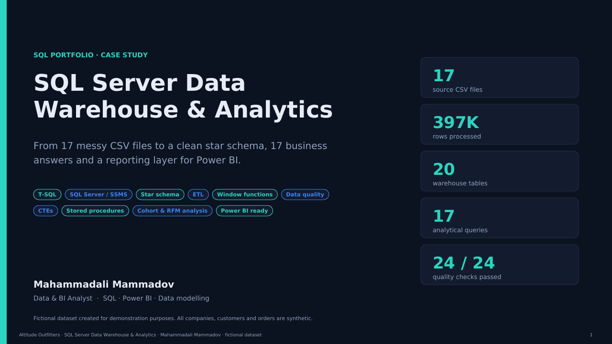
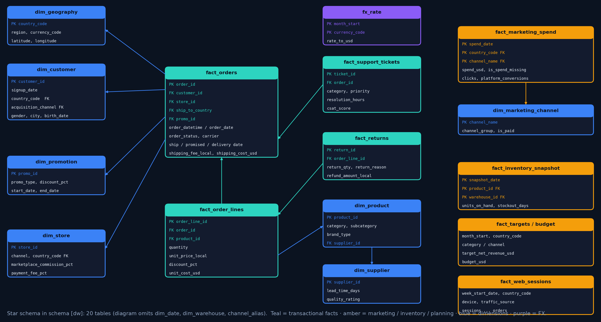

# Altitude Outfitters — SQL Server Data Warehouse & Analytics

> **Fictional dataset created for demonstration purposes.** All companies, customers and orders are synthetic.

An end-to-end T-SQL project: **17 messy CSV files → staging → clean star schema → reporting views → 17 business answers**, built for Microsoft SQL Server (SSMS).



## The business problem
Altitude Outfitters is an outdoor-gear retailer selling through web shops, marketplaces, flagship stores and B2B in 8 countries and 6 currencies. Sales, returns, support, inventory, marketing and planning data arrive as separate files with different grains (daily, weekly, monthly, month-end), several currencies and inconsistent formats. Leadership cannot tell which channels and customers really make money.

## What I built
| Layer | What it does |
|---|---|
| `stg` | Raw landing tables (all `NVARCHAR`) loaded with `BULK INSERT`, so dirty values never break the load |
| `dw` | Typed star schema: 9 fact tables, 11 dimensions, PK / FK / CHECK constraints, indexes |
| `rpt` | Reporting views with the business rules defined **once** (net revenue, COGS, contribution margin), 2 procedures, 1 table-valued function |
| ETL | `dw.usp_load_dw`: one transaction (`TRY/CATCH`, all-or-nothing), re-runnable |
| QA | 24 automated PASS/FAIL tests + a cleaning audit |



## Repository structure
```
sql/
  00_create_database.sql          database + schemas (stg, dw, rpt)
  01_create_staging_tables.sql    17 staging tables
  02_load_staging.sql             BULK INSERT loop (edit @DataPath)
  03_create_dw_tables.sql         star schema DDL, constraints, indexes
  04_transform_load_dw.sql        cleaning + typing + load (stored procedure)
  05_create_views.sql             rpt.vw_sales_line, vw_order_economics, vw_customer_order, vw_marketing_monthly
  06_data_quality_checks.sql      24 tests + cleaning audit
  07_analytics_queries.sql        17 business questions
  08_procedures_and_functions.sql parameterised procedures + inline TVF
  99_run_all.sql                  SQLCMD master script
data/                             the 17 source CSV files + data dictionary
expected_results/                 expected output of each query (compare with your own run)
docs/                             portfolio PDF, ER diagram
```

## How to run
**Requirements:** SQL Server 2017 or later (Developer / Express is fine) and SSMS.
1. Copy the `data` folder to the server, e.g. `C:\AltitudeOutfitters\data\` (the SQL Server service account needs read access).
2. Open `sql/02_load_staging.sql` and set `@DataPath` to that folder (must end with `\`).
3. Run scripts **00 → 06**, then `08` in order (or open `99_run_all.sql` in **SQLCMD mode** after editing `ScriptPath`).
4. Run `06_data_quality_checks.sql`: every test should return `PASS`.
5. Open `07_analytics_queries.sql` and run the queries one by one; compare with `expected_results/`.

## Data quality problems handled (04 + 06)
Duplicate customers and order lines · two timestamp formats in one column · inconsistent gender / city / category / payment / marketing-channel spellings · placeholder birth dates · blank discounts and missing spend · carriers on cancelled orders. Each fix is rule-based and counted in the audit.

## Business definitions
- **Net revenue (USD)** = `quantity × unit_price_local × (1 − discount_pct) × rate_to_usd` (rate of the order month); cancelled orders excluded (`is_valid_sale = 1`).
- **Contribution margin** = net revenue − COGS − marketplace commission − payment fees + shipping fees charged − carrier cost − refunds (refunds converted at the order-month rate).

## Selected findings
| Question | Finding |
|---|---|
| Which channel really makes money? (Q02) | Marketplace: 51.2% gross margin but only **24.5%** contribution margin (Web 36.4%) |
| Are deeper discounts hurting? (Q08) | Black Friday discount 20% → 25% → 30%; gross margin 38.8% → 34.4% → 31.0% |
| Currency vs real growth (Q09) | Turkey Jan–Sep 2026: **+100%** in lira, **+69%** in USD |
| Failing carrier (Q10) | SwiftCargo late rate 22% → **56%** in Q3 2025 (others ≈ 12%), alert fires automatically |
| Does lateness matter? (Q17) | CSAT 4.07 on time vs **3.12** late; unhappy customers 3.0% vs 23.8% |
| Customer value (Q06/Q07) | Champions: 6.5% of customers, 25.8% of revenue; top decile = 43.5% of revenue |
| Supplier quality (Q12) | Supplier S05 defective share of returns 25% (2024) → 43% (2025) |
| Inventory (Q13) | ~50% of inventory value is overstock or dead stock |
| Ad platforms (Q14) | Platforms report 1.9× (Meta) and 2.3× (TikTok) more conversions than real new customers |

## Techniques demonstrated
CTEs · window functions (`LAG`, `ROW_NUMBER`, `RANK`, `NTILE`, running and moving frames) · conditional aggregation · cohort analysis · RFM scoring · Pareto/ABC · constant-currency analysis · gaps-and-islands · semi-additive inventory measures · stored procedures with `TRY/CATCH` and transactions · inline TVF · constraints and indexes · data-quality testing.

## Portfolio PDF
[`docs/SQL_Portfolio_AltitudeOutfitters.pdf`](docs/SQL_Portfolio_AltitudeOutfitters.pdf) — 13-page visual walkthrough with results.

## Author
Mahammadali Mammadov — Data & BI Analyst (SQL · Power BI · Data modelling)
